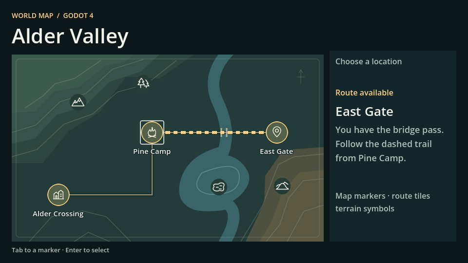

# Alder Valley, a free Godot 4.6 RPG world map

Preview a six-tile route, show why a destination is locked, and place four terrain symbols on a 2D map. The project includes an editable GDScript scene.

[Play in your browser](https://small-hours-assets.vercel.app/guides/godot-world-map?utm_source=github_world_map_project) · [Download the Godot project ZIP](https://github.com/yaotao3000/godot-world-map-free/releases/latest/download/small-hours-godot-world-map-free-project.zip) · [Watch the 61-second tutorial](https://www.youtube.com/watch?v=sb3LY0ox1tk) · [Try the bridge-pass scene](#unlock-east-gate-with-a-bridge-pass)


Import `project.godot` in Godot 4.6 and press F5. Select Pine Camp to preview a route. Select East Gate to inspect the locked state. Use the mouse or Tab and Enter.

## Bring it into your own game

Copy `world_map.tscn`, `world_map.gd`, `world_map.json` and `art/` into a new 2D project at its root. Open the scene and press F6. Point `background` in `world_map.json` at your own map image in `art/`. Keep the 640 × 384 logical canvas and update each center in `position` using coordinates measured from the top left. Keep route tile centers 64 pixels apart for seamless joins. Edit location names and details in JSON. Add a destination route by mapping its ID under `routes`, using the supplied tile names or extra tiles from the Map Route Tiles pack. A location without a route entry still shows its details.

## Add a route to East Gate

The free project starts with a locked gate. Try the following in a copy of the project.

1. In `world_map.json`, find `gate` under `places`. Set its `status` to `Route available` and update its `detail` to explain that the bridge pass was granted.
2. Add the `gate` entry below to the existing `routes` object alongside `camp`, separated by a comma.
3. Save the file, press F5 and select East Gate. Five tiles connect Pine Camp to the gate. The last cap rotates 180° to face the trail.

```json
{
  "gate": [
    {"tile": "end_e", "position": [288, 160]},
    {"tile": "straight_ew", "position": [352, 160]},
    {"tile": "straight_ew", "position": [416, 160]},
    {"tile": "straight_ew", "position": [480, 160]},
    {"tile": "end_e", "position": [544, 160], "rotation": 180}
  ]
}
```

In your game, use your quest or inventory state to decide when the bridge pass reveals the route.

## Unlock East Gate with a bridge pass

Open [`examples/bridge_pass_map.tscn`](examples/bridge_pass_map.tscn) in Godot 4.6 and press **F6**. If you started with the v1.0.0 ZIP, place the [scene](examples/bridge_pass_map.tscn) and [GDScript](examples/world_map_bridge_pass.gd) in an `examples/` folder next to `project.godot` first.

1. Select **East Gate**. It shows **Locked** and the route stays hidden.
2. Select **Pine Camp**, then **Take bridge pass**.
3. Select **East Gate** again. Five dashed tiles connect the camp to the gate.



Call `set_bridge_pass(owned)` on the map after it is ready whenever your game's inventory or quest state changes. The sample keeps ownership in memory for the current run. Connect your own save system if the pass should persist. The separate scene uses the free project art and keeps the original map scene available with **F5**.

[Try the original world map in your browser](https://small-hours-assets.vercel.app/guides/godot-world-map?utm_source=github_world_map_project) · [Find the route and quest icon packs in the Black Friday sale](https://small-hours-assets.vercel.app/black-friday?utm_source=github_world_map_project)

## What you get

One editable scene, one replaceable map diagram, and 11 transparent 64 × 64 PNGs drawn from three free samples. This demo previews routes from data. Its example states are supplied in the project data for you to connect to your game.

- [Read the Godot guide](https://small-hours-assets.vercel.app/guides/godot-world-map?utm_source=github_world_map_project)
- [Browse the Small Hours Black Friday packs](https://small-hours-assets.vercel.app/black-friday?utm_source=github_world_map_project)
- Exploration Map Markers — https://yaotao3000.itch.io/exploration-map-markers
- Map Route Tiles — https://yaotao3000.itch.io/map-route-tiles
- World Map Terrain Symbols — https://yaotao3000.itch.io/world-map-terrain-symbols

Small Hours used AI assistance with vector design, code and documentation. See LICENSE.txt.
