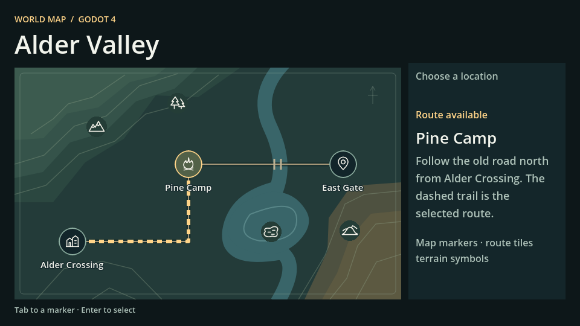

# Alder Valley, a free Godot 4.6 RPG world map

Preview a six-tile route, show why a destination is locked, and place four terrain symbols on a 2D map. The project includes an editable GDScript scene.

[Play in your browser](https://small-hours-assets.vercel.app/guides/godot-world-map?utm_source=github_world_map_project) · [Download the Godot project ZIP](https://github.com/yaotao3000/godot-world-map-free/releases/latest/download/small-hours-godot-world-map-free-project.zip)

Import `project.godot` in Godot 4.6 and press F5. Select Pine Camp to preview a route. Select East Gate to inspect the locked state. Use the mouse or Tab and Enter.

## Bring it into your own game

Copy `world_map.tscn`, `world_map.gd`, `world_map.json` and `art/` into a new 2D project at its root. Open the scene and press F6. Point `background` in `world_map.json` at your own map image in `art/`. Keep the 640 × 384 logical canvas and update each center in `position` using coordinates measured from the top left. Keep route tile centers 64 pixels apart for seamless joins. Edit location names and details in JSON. Add a destination route by mapping its ID under `routes`, using the supplied tile names or extra tiles from the Map Route Tiles pack. A location without a route entry still shows its details.

## What you get

One editable scene, one replaceable map diagram, and 11 transparent 64 × 64 PNGs drawn from three free samples. This demo previews routes from data. Its example states are supplied in the project data for you to connect to your game.

- [Read the Godot guide](https://small-hours-assets.vercel.app/guides/godot-world-map?utm_source=github_world_map_project)
- [Browse the Small Hours Black Friday packs](https://small-hours-assets.vercel.app/black-friday?utm_source=github_world_map_project)
- Exploration Map Markers — https://yaotao3000.itch.io/exploration-map-markers
- Map Route Tiles — https://yaotao3000.itch.io/map-route-tiles
- World Map Terrain Symbols — https://yaotao3000.itch.io/world-map-terrain-symbols

Small Hours used AI assistance with vector design, code and documentation. See LICENSE.txt.
