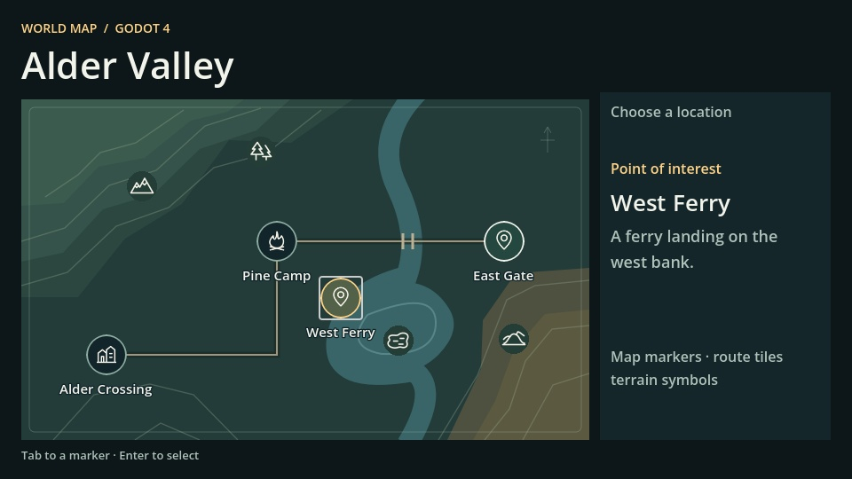

# 在 Godot 4 世界地图上添加地点标记

在 Alder Valley 地图上加入一个可点击的 West Ferry 渡口。本例用现成的路标 PNG，改一个 JSON 文件即可。



1. [下载免费 Godot 4.6 工程](https://github.com/yaotao3000/godot-world-map-free/releases/download/v1.0.0/small-hours-godot-bridge-pass-free-project.zip)并解压。
2. [下载完整 JSON 示例](https://raw.githubusercontent.com/yaotao3000/godot-world-map-free/main/docs/examples/world-map-with-west-ferry.json)，将它保存为 `world_map.json`，替换工程根目录的同名文件。
3. 在 Godot 中导入 `project.godot`，按 **F5**。点击 **West Ferry**，或者用 **Tab** 聚焦后按 **Enter**。右栏会显示 **Point of interest** 及渡口说明。

要在自己的数据里添加地点，把以下对象加到 `world_map.json` 的 `places` 数组：

```json
{
  "id": "west_ferry",
  "name": "West Ferry",
  "icon": "sh_exploration_map_markers_waypoint_light_64.png",
  "position": [360, 224],
  "status": "Point of interest",
  "detail": "A ferry landing on the west bank."
}
```

给每个地点一个不同的 `id`。`icon` 填工程 `art/` 目录里的文件名。`position` 是图标中心，以 640 × 384 地图左上角为原点。这个例子只需在右栏显示渡口详情，因此 West Ferry 无需加入 `routes`。

[英文教程、免费工程与配套标记素材](https://small-hours-assets.vercel.app/guides/godot-world-map-custom-marker?utm_source=github_world_map_marker_tutorial)
